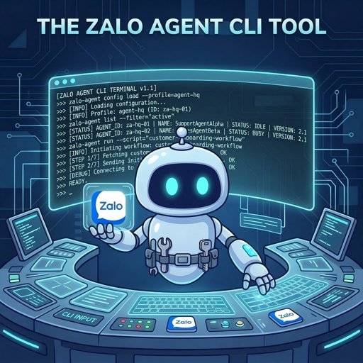
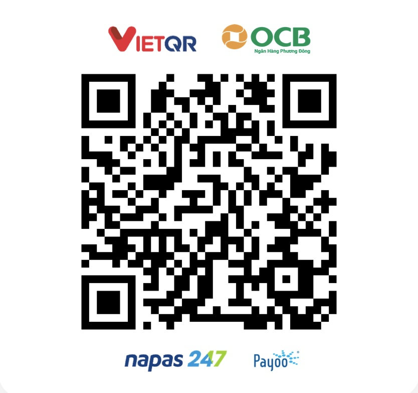

<p align="center">
  
</p>

<h1 align="center">zalo-agent-cli</h1>

<p align="center">
  
</p>

<p align="center">
  <a href="https://www.npmjs.com/package/zalo-agent-cli"></a>
  <a href="https://www.npmjs.com/package/zalo-agent-cli"></a>
  <a href="https://www.npmjs.com/package/zalo-agent-cli"></a>
  <a href="https://github.com/trunghoang0501/zalo-agent-cli/blob/main/LICENSE"></a>
</p>

<p align="center">
  A CLI tool for Zalo automation — multi-account, proxy support, bank transfers, and QR payments.<br/>
  Built on top of <a href="https://github.com/RFS-ADRENO/zca-js">zca-js</a>.
</p>

> [!WARNING]
> This tool relies on an **unofficial** Zalo API ([zca-js](https://github.com/RFS-ADRENO/zca-js)). Zalo does not support it, and **your account may be locked or banned**. Use at your own risk. Not affiliated with Zalo or VNG. See [DISCLAIMER.md](DISCLAIMER.md).

> [!TIP]
> **AI Agent Skill** — Use with OpenClaw, Claude Code, or any SKILL.md-compatible agent:
> ```bash
> clawhub install zalo-agent                  # OpenClaw (from ClawHub registry)
> cp -r skill/ ~/.claude/skills/zalo-agent/    # Claude Code
> ```
> 15+ command groups · listen mode + webhook · 55+ VN banks · multi-account + proxy
> See [skill/SKILL.md](skill/SKILL.md) · [Eval scenarios](skill/evals/)

> [!NOTE]
> **Zalo Official Account (OA)** — official Zalo OA API v3.0 support:
> ```bash
> zalo-agent oa init                                              # Setup wizard (interactive)
> zalo-agent oa init --app-id <ID> --secret <KEY> --skip-webhook  # Non-interactive (AI agent)
> zalo-agent oa whoami                                            # OA profile
> zalo-agent oa msg text <user-id> "Hello"                        # Send a message
> zalo-agent oa listen -p 3000                                    # Webhook listener
> ```
> OAuth login · messaging · follower management · tags · webhook listener · VPS support
> See [docs/official-account.md](docs/official-account.md)

> [!TIP]
> **MCP Server (AI Agent Integration)** — Model Context Protocol support for Claude Code and other MCP clients:
> ```bash
> zalo-agent mcp start                                  # stdio (local Claude Code)
> zalo-agent mcp start --http 3847 --auth your-secret   # HTTP (VPS)
> ```
> 4 tools: `get_messages` · `send_message` · `list_threads` · `mark_read`
> Auto-reconnect · thread filtering · noise reduction · group notifications
> See the [MCP Guide](skill/references/mcp-guide.md)

---

## Installation

```bash
npm install -g zalo-agent-cli
```

## Quick Start

```bash
zalo-agent login                           # 1. Log in via QR code
zalo-agent friend search "Name"            # 2. Find a friend
zalo-agent listen                          # 3. Listen for incoming messages (threadId)
zalo-agent msg send <THREAD_ID> "Hello!"   # 4. Send a message
```

1. **Log in** — run `zalo-agent login`, then scan the QR code with **Zalo app > Scan QR**. Credentials are saved automatically.
2. **Find a friend** — `zalo-agent friend search "Name"`.
3. **Listen for messages** — `zalo-agent listen` prints the `threadId` for each incoming message (add `--json` for structured output).
4. **Send a message** — to a person: `zalo-agent msg send <THREAD_ID> "Hello!"`; to a group: `zalo-agent msg send <THREAD_ID> "Hello group!" -t 1`.

---

## Commands

Every command supports `--json`. Full documentation: **[Wiki](https://github.com/trunghoang0501/zalo-agent-cli/wiki)**

| Group | Description | Docs |
|-------|-------------|------|
| `msg` | Text, images, files, voice, video, stickers, links, bank cards, QR | [Messages](https://github.com/trunghoang0501/zalo-agent-cli/wiki/Messages) |
| `friend` | List, find, add, remove, block, alias, recommendations | [Friends](https://github.com/trunghoang0501/zalo-agent-cli/wiki/Friends) |
| `group` | Create, rename, members, settings, links, notes, invites | [Groups](https://github.com/trunghoang0501/zalo-agent-cli/wiki/Groups) |
| `conv` | Mute, pin, archive, hide, auto-delete | [Conversations](https://github.com/trunghoang0501/zalo-agent-cli/wiki/Conversations) |
| `profile` | Profile, avatar gallery, privacy | [Profile](https://github.com/trunghoang0501/zalo-agent-cli/wiki/Profile) |
| `poll` | Create, vote, lock polls | [Polls](https://github.com/trunghoang0501/zalo-agent-cli/wiki/Polls) |
| `reminder` | Create, edit, remove reminders | [Reminders](https://github.com/trunghoang0501/zalo-agent-cli/wiki/Reminders) |
| `auto-reply` | Auto-reply rules | [Auto-Reply](https://github.com/trunghoang0501/zalo-agent-cli/wiki/Auto-Reply) |
| `quick-msg` | Saved quick messages | [Quick Messages](https://github.com/trunghoang0501/zalo-agent-cli/wiki/Quick-Messages) |
| `label` | Conversation labels | [Labels](https://github.com/trunghoang0501/zalo-agent-cli/wiki/Labels) |
| `catalog` | zBusiness catalogs & products | [Catalog](https://github.com/trunghoang0501/zalo-agent-cli/wiki/Catalog) |
| `listen` | Real-time listener, webhook, JSONL | [Listener](https://github.com/trunghoang0501/zalo-agent-cli/wiki/Listener) |
| `account` | Multi-account & proxy | [Accounts](https://github.com/trunghoang0501/zalo-agent-cli/wiki/Accounts) |
| **`oa`** | **Zalo Official Account API v3.0 — OAuth, messaging, followers, webhook** | **[Official Account](https://github.com/trunghoang0501/zalo-agent-cli/wiki/Official-Account)** |

See also: [Multi-Account & Proxy](https://github.com/trunghoang0501/zalo-agent-cli/wiki/Multi-Account-&-Proxy) · [VPS Setup](https://github.com/trunghoang0501/zalo-agent-cli/wiki/VPS-Setup) · [Bank Cards & QR](https://github.com/trunghoang0501/zalo-agent-cli/wiki/Bank-Cards-&-QR) · [Official Account](https://github.com/trunghoang0501/zalo-agent-cli/wiki/Official-Account)

---

## Features

- Automatic QR login via a local HTTP server (browser + terminal)
- Multi-account support with per-account proxy (1:1)
- 90+ commands covering the full range of Zalo features
- **Zalo Official Account (OA) API v3.0** — OAuth login, messaging, follower management, webhook listener
- Bank transfer cards (55+ Vietnamese banks) and VietQR payments
- Real-time listener with webhook support and local JSONL logging
- `--json` output on every command — built for scripting and AI agents
- Credentials encrypted at rest (`0600` permissions)
- **Dual mode**: interactive (for humans) and non-interactive (for AI agents, CI/CD)

---

## Support This Project

If this tool saves you time, consider buying us a coffee!

<p align="center">
  
  <br/>
  <em>Scan with any Vietnamese banking app</em>
</p>

---

## Star History

[](https://star-history.com/#trunghoang0501/zalo-agent-cli&Date)

## License

[MIT](LICENSE) · See [DISCLAIMER.md](DISCLAIMER.md) for full terms.
